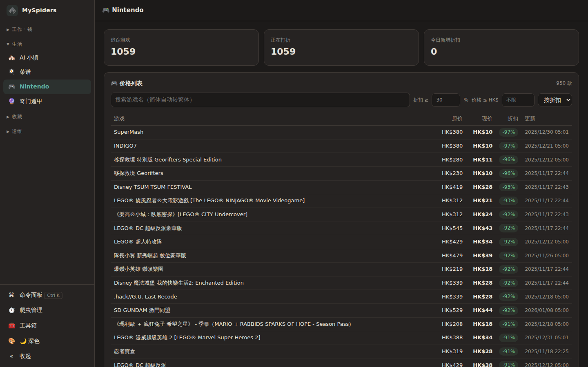
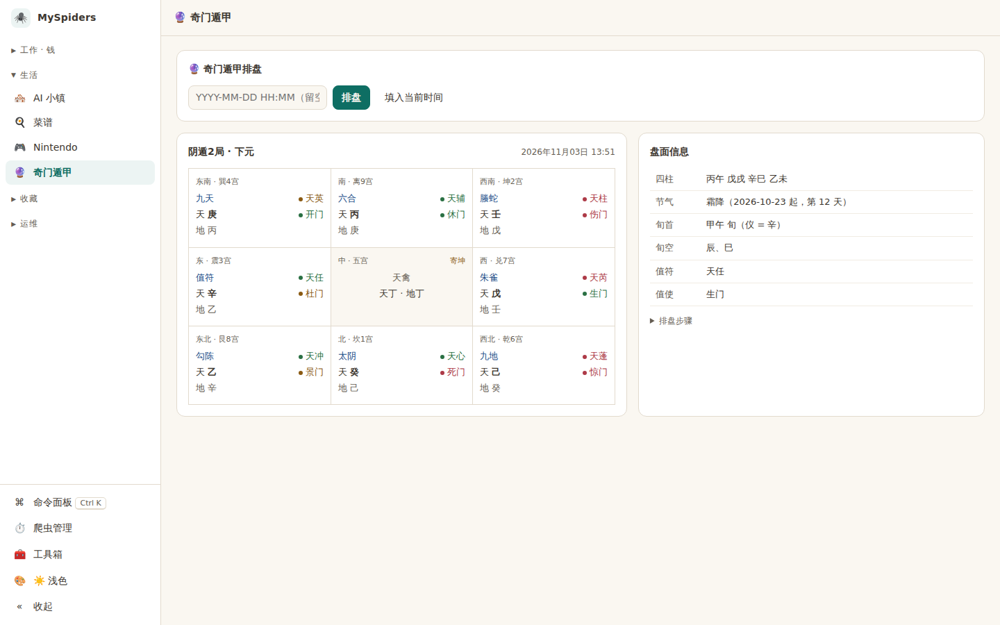
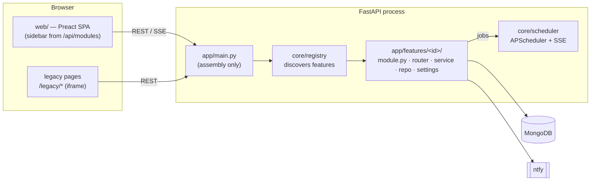

# MySpiders

**English** · [简体中文](README.zh-CN.md)

[](https://github.com/glzhangzhi/myspiders/actions/workflows/ci.yml)
[](LICENSE)

A self-hosted, single-user dashboard that gathers my scattered scrapers, monitors and small automations into **one process, one scheduler and one UI** — price watches, LLM spending, a recipe library that pushes to a Kindle, a SillyTavern asset browser, and more. Notifications go out through [ntfy](https://ntfy.sh).

It is built around a **module registry**: every feature is a self-contained package under `app/features/<id>/` that declares its routes, scheduled jobs, lifecycle hooks and navigation entry. The core knows nothing about individual features, so adding one is "add a directory", and removing one is "delete a directory".

> This public repository contains the core and the general-purpose modules. A few personal modules (account-specific integrations) live in a private fork and plug into the same registry; nothing in this repo depends on them.

<p align="center">
  
  
</p>

## Features

| Module | What it does |
|---|---|
| **System** | Job manager with live status over SSE (enable / disable / run now), disk / MongoDB / Google Drive usage, daily backup (`mongodump` + `rclone`), manual ntfy push, one-click service restart |
| **Nintendo** | Tracks the Hong Kong eShop, highlights new discounts, client-side filtering and sorting; search accepts Simplified Chinese (converted to Traditional server-side) |
| **Joybuy** | Watches a single product's price from three independent sources that must agree; never falls back to `0` on a parse failure |
| **Claude usage** | Polls the Claude account usage API adaptively (30 min when idle, 5 min near a limit), heatmaps of when quota is spent |
| **LLM usage** | Ingests token usage from several local LLM front-ends and prices it per model, grouped by project |
| **Recipes** | Recipe library (imports [HowToCook](https://github.com/Anduin2017/HowToCook)), tag vocabulary, AI conversion of free-form recipes via DeepSeek, shopping list, push to a Kindle running KOReader over SSH |
| **Finance** | Imports N26 PDF statements, refuses to import if the balances do not reconcile, rule-based categorisation you can override per transaction |
| **Tavern** | Read-only browser for SillyTavern character cards / lorebooks / presets and chat export; writes go through `tavern_sync` |
| **Media** | Detects new videos from followed channels / playlists on a remote Windows machine and downloads them on demand |
| **Qimen** | Qimen Dunjia (奇门遁甲) chart calculation |

## Tech stack

| Layer | Technology |
|---|---|
| Backend | **Python 3.12**, **FastAPI** + Uvicorn, Pydantic v2 / pydantic-settings, sse-starlette |
| Scheduling | **APScheduler** (`AsyncIOScheduler`), enable state persisted in MongoDB |
| Storage | **MongoDB 8** via PyMongo |
| Scraping | httpx, requests, **Playwright** (headless Chromium) |
| AI | DeepSeek API (recipe conversion), Anthropic usage API |
| Frontend | **Vite 6**, **Preact 10** + **TypeScript 5**, @preact/signals, preact-iso router, **uPlot** (lazy-loaded charts) |
| Testing | pytest (500+ tests; a throwaway MongoDB for a few repo tests), Vitest, Playwright smoke tests |
| Ops | systemd, ntfy, rclone → Google Drive, a reverse proxy / tunnel with access control in front |
| Misc | sxtwl (Chinese calendar), OpenCC (Simplified ↔ Traditional) |

## Architecture



```
app/
├── main.py            # assembles the app from the registry — no feature imports
├── __main__.py        # `python -m app` entry point (see "Running")
├── core/              # settings, registry, scheduler, cache, push, paths, SPA serving
├── features/<id>/     # one package per feature
│   ├── module.py      # MODULE = Module(id, routers, jobs, nav, hooks, …)
│   ├── settings.py    # feature config, merged into the global `settings`
│   ├── router.py      # HTTP layer only
│   ├── service.py     # business logic
│   └── repo.py        # MongoDB access
└── dashboard/         # not-yet-migrated legacy HTML pages + build output (dist/)
web/                   # Vite + Preact + TypeScript frontend
tests/                 # pytest — pure functions, assembly, boundary and lint gates
```

### Writing a module

```python
# app/features/hello/module.py
from apscheduler.triggers.interval import IntervalTrigger
from fastapi import APIRouter
from app.core.module import Job, Module, NavItem

router = APIRouter(prefix="/api/hello")

@router.get("")
def hello():
    return {"hello": "world"}

def ping():
    print("still alive")

MODULE = Module(
    id="hello", title="Hello",
    routers=[router],
    jobs=lambda: [Job("hello_ping", "Ping", ping, IntervalTrigger(minutes=5), schedule="every 5 min")],
    nav=[NavItem("hello", "Hello", "👋", group="life")],
)
```

Restart the service — the route, the job (visible in the job manager) and the sidebar entry all appear. Feature configuration goes in `settings.py` as a `pydantic.BaseModel` subclass; environment variable names equal field names.

## Getting started

**Requirements:** Python 3.12, Node.js ≥ 20 with pnpm, MongoDB, and optionally `poppler-utils` (PDF statements) and `rclone` (backups).

```bash
git clone https://github.com/glzhangzhi/myspiders.git && cd myspiders

# backend
python3.12 -m venv .venv && . .venv/bin/activate
pip install -r requirements.txt
playwright install chromium          # only needed by the Nintendo scraper
cp .env.example .env                 # set ADMIN_TOKEN, MONGO_URI, …

# frontend
pnpm -C web install && pnpm -C web build

# run
python -m app --port 12312           # → http://127.0.0.1:12312/dashboard
```

> **Note for arm64:** `sxtwl` ships no aarch64 wheel and its sdist is incomplete; build it from the upstream [`yuangu/sxtwl_cpp`](https://github.com/yuangu/sxtwl_cpp) `python/` directory with `pip install --no-build-isolation .`.

### Running

- **Use `python -m app`, not the `uvicorn` CLI.** The entry point imports `sse-starlette` *before* Uvicorn installs its signal handlers; otherwise an open SSE connection blocks graceful shutdown until the process is killed.
- Production: see [`deploy/systemd/myspider.service`](deploy/systemd/myspider.service) and `scripts/deploy.sh` (tests → frontend build → restart; `--web-only` rebuilds the frontend without a restart).
- Bind to `127.0.0.1` and put the dashboard behind a reverse proxy or tunnel **with authentication**. Write endpoints require the `x-token` header (`ADMIN_TOKEN`).
- Development: set `BACKGROUND_TASKS_ENABLED=false` and a separate `MONGO_DEFAULT_DB` for an API-only instance; run `pnpm -C web dev` (port 5173, proxies `/api` to port 8000).

### Tests

```bash
pytest                      # backend: 500+ tests (a few need a local MongoDB)
pnpm -C web check           # typecheck + vitest + build + first-load size budget (80 KB gzip)
python scripts/e2e_smoke.py # headless browser opens every page, fails on console errors
```

## Design notes

- **Missed jobs are not replayed** (MemoryJobStore, `misfire_grace_time=1`). Anything that must survive downtime is idempotent and catches up on startup instead.
- **Notification priority is policy, not taste.** `app/core/push.py` documents how each ntfy priority behaves on the phone; a test scans every call site with `ast` and fails if one omits `priority` or uses `default`.
- **Slow probes use stale-while-revalidate** (`app/core/cache.py`): `du`, `rclone about` or an SSH reachability check return the last answer instantly and refresh in the background.
- **Theme** colours live in a single `theme.css` shared by the new SPA and the legacy pages, with dark, light and follow-system modes; each colour is contrast-checked (≥ 4.5 for text).
- **Privacy gate:** `scripts/check_public.py` scans the tree for IPs, IBANs, tokens, private keys and personal identifiers and runs in CI.

## License

[MIT](LICENSE)
