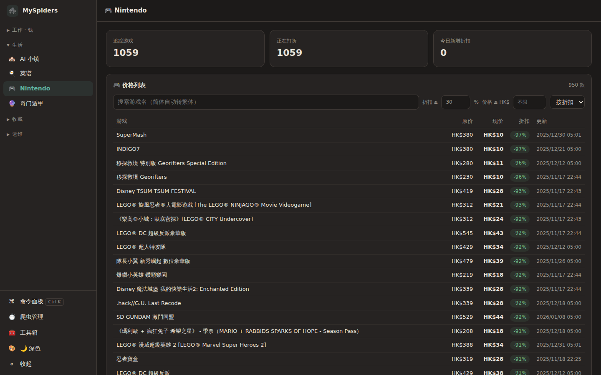
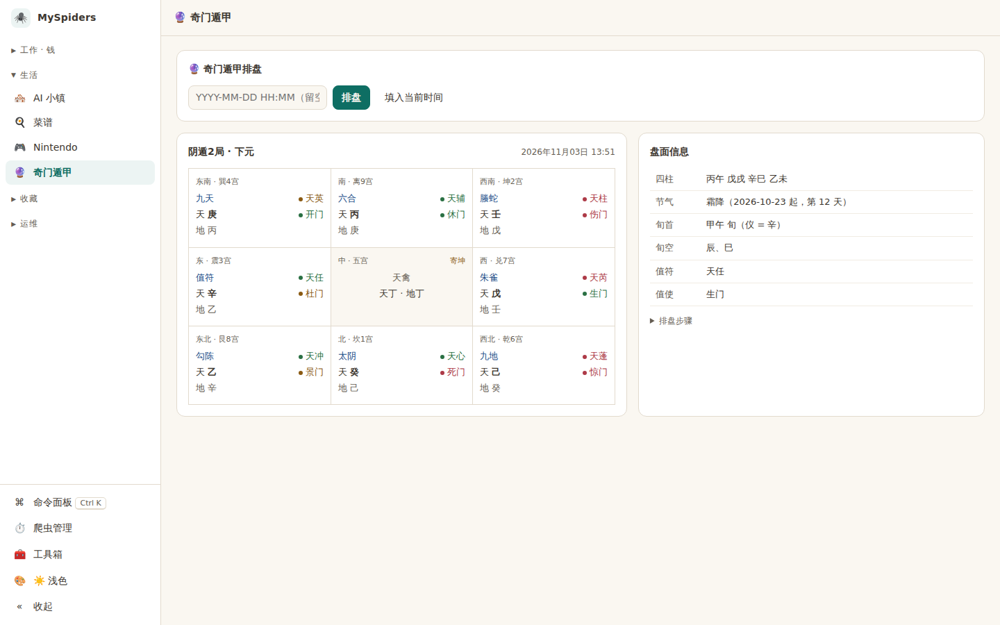
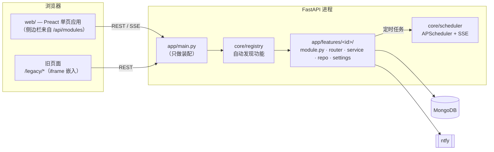

# MySpiders

[English](README.md) · **简体中文**

[](https://github.com/glzhangzhi/myspiders/actions/workflows/ci.yml)
[](LICENSE)

一个自托管、单人自用的管理面板：把散落各处的小爬虫、监控和自动化收进**一个进程、一个调度器、一个界面** —— 价格监控、LLM 花费统计、能推送到 Kindle 的菜谱库、SillyTavern 资料浏览、AI 小镇模拟、手机计时 PWA 等等。告警统一走 [ntfy](https://ntfy.sh) 推到手机。

核心是一个**模块注册表**：每个功能都是 `app/features/<id>/` 下一个自包含的包，自己声明路由、定时任务、生命周期钩子和导航入口。核心代码不认识任何具体功能 —— 加功能就是加一个目录，删功能就是删一个目录。

> 本公开仓库包含核心与通用功能模块。另有少量个人模块（与具体账号绑定的集成）放在私有仓库里，接入同一个注册表；本仓库的代码不依赖它们。

<p align="center">
  
  
</p>

## 功能

| 模块 | 做什么 |
|---|---|
| **系统** | 爬虫管理（SSE 实时状态，启停 / 立即运行）、磁盘 / MongoDB / Google Drive 用量、每日备份（`mongodump` + `rclone`）、手动推送、一键重启服务 |
| **Nintendo** | 追踪港服 eShop 价格，标出今日新增折扣，浏览器内筛选排序；搜索支持简体（服务端转繁体） |
| **Joybuy** | 盯一个商品的价格，三个独立价格源必须互证，解析失败绝不兜底成 0 |
| **Claude 用量** | 自适应轮询 Claude 账户用量（闲时 30 分钟、逼近上限 5 分钟），预测窗口结束时的用量，热力图看额度花在什么时段 |
| **LLM 用量** | 汇总多个本地 LLM 前端的 token 消耗，按模型计价、按项目归类 |
| **菜谱** | 菜谱库（导入 [HowToCook](https://github.com/Anduin2017/HowToCook)）、标签词表、DeepSeek 把随手写的菜谱转成结构化格式、购物清单、经 SSH 推送到装了 KOReader 的 Kindle |
| **账单** | 导入 N26 对账单 PDF，余额勾稽不平就拒绝入库，按规则自动分类、可逐条改 |
| **酒馆资料** | 只读浏览 SillyTavern 的角色卡 / 世界书 / 预设与聊天导出；写操作一律走 `tavern_sync` |
| **AI 小镇** | 酒馆角色卡住进同一个小镇，一步 = 一天（选地点 → 按地点演一场戏 → 写日记，日记即记忆） |
| **计时** | 可安装到手机的 PWA，只存不可变的操作日志、记录由重放得到；服务端推送空闲 / 超时提醒 |
| **下载** | 在另一台 Windows 机器上检测关注的视频号作者 / YouTube 列表的新内容，按需下载 |
| **奇门遁甲** | 时家奇门排盘 |

## 技术栈

| 层 | 技术 |
|---|---|
| 后端 | **Python 3.12**、**FastAPI** + Uvicorn、Pydantic v2 / pydantic-settings、sse-starlette |
| 调度 | **APScheduler**（`AsyncIOScheduler`），启停状态持久化在 MongoDB |
| 存储 | **MongoDB 8**（PyMongo） |
| 抓取 | httpx、requests、**Playwright**（无头 Chromium） |
| AI | DeepSeek API（菜谱转换、AI 小镇）、Anthropic 用量接口 |
| 前端 | **Vite 6**、**Preact 10** + **TypeScript 5**、@preact/signals、preact-iso 路由、**uPlot**（图表按需加载） |
| 测试 | pytest（500+ 个用例，无需数据库）、Vitest、Playwright 冒烟测试 |
| 运维 | systemd、ntfy、rclone → Google Drive，前面挂带访问控制的反向代理 / 隧道 |
| 其它 | sxtwl（寿星天文历，农历节气）、OpenCC（简繁转换） |

## 架构



```
app/
├── main.py            # 从注册表装配应用 —— 不 import 任何具体功能
├── __main__.py        # `python -m app` 启动入口（见「运行」）
├── core/              # 配置、注册表、调度器、缓存、推送、路径、前端静态服务
├── features/<id>/     # 一个功能一个包
│   ├── module.py      # MODULE = Module(id, routers, jobs, nav, 钩子, …)
│   ├── settings.py    # 功能自己的配置，自动混入全局 `settings`
│   ├── router.py      # 只解析参数、转发
│   ├── service.py     # 业务逻辑
│   └── repo.py        # MongoDB 访问
└── dashboard/         # 尚未迁移的旧版 HTML 页面 + 前端构建产物（dist/）
web/                   # Vite + Preact + TypeScript 前端
tests/                 # pytest —— 纯函数、装配、边界与静态检查
```

### 写一个模块

```python
# app/features/hello/module.py
from apscheduler.triggers.interval import IntervalTrigger
from fastapi import APIRouter
from app.core.module import Job, Module, NavItem

router = APIRouter(prefix="/api/hello")

@router.get("")
def hello():
    return {"hello": "world"}

def ping():
    print("still alive")

MODULE = Module(
    id="hello", title="你好",
    routers=[router],
    jobs=lambda: [Job("hello_ping", "Ping", ping, IntervalTrigger(minutes=5), schedule="每 5 分钟")],
    nav=[NavItem("hello", "你好", "👋", group="life")],
)
```

重启服务，路由、定时任务（出现在爬虫管理里）和侧边栏入口就都有了。功能配置写在 `settings.py`（一个 `pydantic.BaseModel` 子类），环境变量名与字段名相同。

## 快速开始

**依赖：** Python 3.12、Node.js ≥ 20 与 pnpm、MongoDB；可选 `poppler-utils`（导入 PDF 对账单）和 `rclone`（备份）。

```bash
git clone https://github.com/glzhangzhi/myspiders.git && cd myspiders

# 后端
python3.12 -m venv .venv && . .venv/bin/activate
pip install -r requirements.txt
playwright install chromium          # 只有 Nintendo 爬虫需要
cp .env.example .env                 # 填 ADMIN_TOKEN、MONGO_URI 等

# 前端
pnpm -C web install && pnpm -C web build

# 运行
python -m app --port 12312           # → http://127.0.0.1:12312/dashboard
```

> **arm64 注意：** `sxtwl` 没有 aarch64 的 wheel，PyPI 上的源码包也不完整，需要从上游 [`yuangu/sxtwl_cpp`](https://github.com/yuangu/sxtwl_cpp) 的 `python/` 目录 `pip install --no-build-isolation .` 构建。

### 运行

- **用 `python -m app` 启动，不要用 `uvicorn` 命令行。** 入口会在 Uvicorn 装信号处理器**之前**导入 `sse-starlette`；否则只要有一条 SSE 连接开着，优雅关闭就会一直卡住，直到进程被强杀。
- 生产部署：参考 [`deploy/systemd/myspider.service`](deploy/systemd/myspider.service) 与 `scripts/deploy.sh`（测试 → 构建前端 → 重启；`--web-only` 只重建前端、不重启）。
- 只绑 `127.0.0.1`，对外放在**带认证**的反向代理或隧道后面。写操作需要请求头 `x-token`（即 `ADMIN_TOKEN`）。
- 开发：`.env` 设 `BACKGROUND_TASKS_ENABLED=false` 和单独的 `MONGO_DEFAULT_DB`，得到一个只提供 API 的实例；`pnpm -C web dev`（5173 端口，`/api` 代理到 8000）。

### 测试

```bash
pytest                      # 后端：500+ 个用例，不需要数据库
pnpm -C web check           # 类型检查 + vitest + 构建 + 首屏体积预算（gzip 80 KB）
python scripts/e2e_smoke.py # 无头浏览器打开每个页面，有控制台报错即失败
```

## 设计要点

- **错过的定时任务不补跑**（MemoryJobStore，`misfire_grace_time=1`）。需要跨停机延续的逻辑都做成幂等、启动时自行补齐。
- **推送优先级是规则不是口味。** `app/core/push.py` 记录了 ntfy 每一档在手机上的实际表现；测试用 `ast` 扫描所有调用点，漏写 `priority` 或用了 `default` 就失败。
- **慢探测走「先回旧值、后台刷新」**（`app/core/cache.py`）：`du`、`rclone about`、SSH 探活都立即返回上次结果，同时在后台更新。
- **配色**只有一份 `theme.css`，新前端和旧页面共用，支持深色 / 浅色 / 跟随系统；每个颜色都校验过对比度（正文 ≥ 4.5）。
- **隐私闸门：** `scripts/check_public.py` 扫描 IP、IBAN、各类 token、私钥与个人标识，在 CI 里运行。

## 许可证

[MIT](LICENSE)
